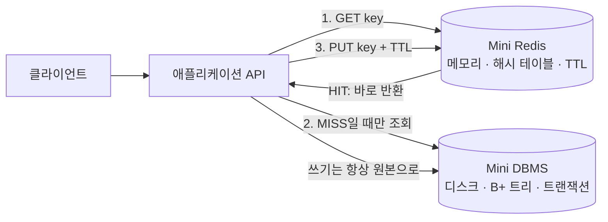
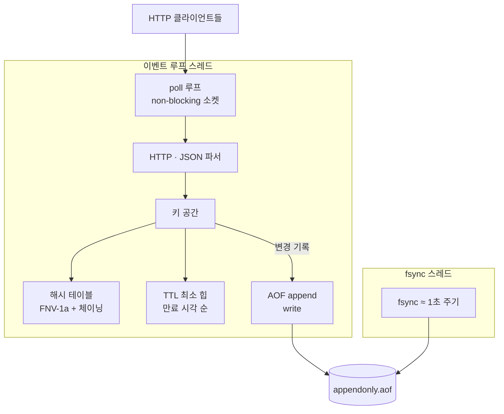
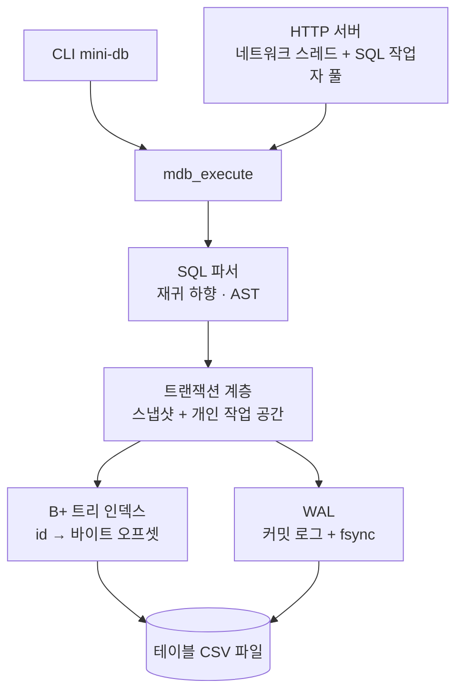

# Mini Redis와 Mini DBMS: 직접 만든 두 개의 저장소

속도를 위한 인메모리 키-값 저장소 Redis와 신뢰성을 위한 디스크 기반 관계형 DBMS를 외부 라이브러리 없이 직접 구현했습니다.
이 문서는 두 구현이 전체 시스템에서 어떤 관계인지, 각각 어떻게 동작하는지, 무엇이 다른지를 정리한 발표용 자료입니다.

## 1. 한눈에 보기

| | Mini Redis | Mini DBMS |
|---|---|---|
| 한 문장 | 메모리에 키-값을 두고 빠르게 읽고 쓰는 서버 | 디스크에 표를 두고 안 잃어버리게 저장하는 서버 |
| 언어·인터페이스 | C++20, HTTP (`PUT/GET/DELETE /keys/{key}`) | C, SQL (CLI, HTTP 서버) |
| 저장 위치 | 메모리 (변경 기록은 AOF 파일) | CSV 파일 + 커밋 로그(WAL) |
| 가장 중요하게 본 것 | 속도: 요청이 서로 안 막히고 메모리에서 바로 응답 | 신뢰성: 중간에 꺼져도 확정한 변경은 남고, 다시 켜면 사람 손 없이 복구 |
| 코드 위치 | `redis/src/` (`engine.hpp`, `aof.hpp`, `http.hpp`, `text.hpp`, `main.cpp`) | `dbms/reliable/src/` (`sql.c`, `engine.c`, `bpt.c`, `server.c`, …) |

## 2. 두 저장소의 관계

두 저장소는 역할이 다른 두 계층입니다.

- Redis는 원본 앞에 두는 캐시입니다. 자주 읽는 결과를 메모리에 잠깐 보관해 원본 호출을 줄입니다. 데이터가 사라져도 원본에서 다시 채울 수 있습니다.
- DBMS는 원본 데이터 저장소입니다. 느리더라도 정확해야 하고, 한 번 확정한 데이터는 프로세스가 죽어도 남아야 합니다.



이 흐름이 캐시 어사이드(cache-aside) 패턴입니다.

1. 먼저 Redis에 묻고, 있으면(HIT) 바로 응답합니다.
2. 없으면(MISS) 원본을 조회합니다.
3. 조회 결과를 TTL과 함께 Redis에 넣어 다음 요청에 대비합니다.
4. 원본이 바뀌면 Redis 키를 `DELETE`해 무효화합니다.

## 3. Mini Redis 동작 원리

> 핵심 질문: "여러 클라이언트가 같은 키를 동시에 읽고 써도 값이 꼬이지 않는가?"



## 4. Mini DBMS 동작 원리

> 핵심 질문: "저장 확정(DURABLE)이라고 응답한 변경이 프로세스가 죽은 뒤에도 남아 있는가?"



## 5. 두 구현의 차이

| 관점 | Mini Redis | Mini DBMS |
| --- | --- | --- |
| 역할 | 캐시 | 원본 데이터 저장소 |
| 데이터 위치 | 메모리가 기준, 디스크는 복구용 | 디스크가 기준, 인덱스만 메모리 |
| 질의 | 키 하나를 정확히 지정하는 GET/PUT/DELETE | SQL: 조건·정렬·`COUNT(*)` |
| 인덱스 | 해시 테이블: 평균 O(1), 정렬 없음 | B+ 트리: 정렬 유지 |
| 동시성 | 단일 스레드 이벤트 루프(키 공간에 락 없음) + fsync 스레드 | 작업자 스레드 풀 + 스냅샷 + 커밋 시 충돌 검사 |
| 여러 변경 묶기 | 없음. 명령 하나가 원자적 | 트랜잭션(BEGIN/COMMIT/ROLLBACK) |
| 로그 | AOF: 명령을 덧붙임 | WAL: 변경 전에 기록 |
| 성공 응답의 의미 | `204` = append + 메모리 반영 (fsync 전) | `DURABLE` = fsync 완료 |
| 장애 시 손실 범위 | 최근 약 1초의 쓰기가 유실될 수 있음 | 확정 응답한 커밋은 보존 |

차이는 두 저장소가 포기한 것이 다르다는 데서 나옵니다.

- Redis는 응답 지연을 허용할 수 없어서 데이터를 메모리에 두고, fsync를 백그라운드로 미루고, 리해싱도 잘게 나눠 실행합니다. 그 대가로 최근 약 1초의 내구성과 복잡한 질의 능력을 포기했습니다.
- DBMS는 데이터를 잃을 수 없어서 커밋마다 fsync를 기다리고, 성공을 `NOT_COMMITTED` / `DURABLE` / `UNKNOWN`으로 구분하며, 여러 변경을 하나로 묶는 트랜잭션을 제공합니다. 그 대가로 쓰기 속도를 포기했습니다.

인덱스 선택도 같은 이유입니다. Redis는 키 하나를 가장 빨리 찾는 해시 테이블을, DBMS는 정렬·범위 질의로 확장할 수 있는 B+ 트리를 골랐습니다.

공통점은 이렇습니다.

- 외부 DB·자료구조 라이브러리 없이 핵심 자료구조(해시 테이블, 힙, B+ 트리)를 직접 구현했습니다.
- 로그를 먼저 쓰고 그다음에 상태를 바꿉니다.
- 시작할 때 로그를 처음부터 재생해 복구합니다. 둘 다 체크포인트와 로그 압축이 없어 로그가 계속 커집니다.
- 실제 `SIGKILL`과 I/O 실패 주입으로 복구를 검증했고, 검증하지 못한 범위(실제 전원 차단 등)는 문서에 밝혔습니다.

## 6. 프로젝트 소개와 연결 지도

기획의도. 서버는 정상인데 고객은 불편한 문제(에러 없이 잘못 동작하는 기능, 화면 개편 후 혼란 등)는 서버 모니터링에 잡히지 않고 고객 문의로만 드러납니다. 여러 상담원에게 흩어진 문의를 모아 문의 급증, 유형 쏠림, 기기·버전 쏠림, 반복 문구를 화면에 보여 주고, 담당 팀이 신호별 진행 상태까지 남길 수 있게 했습니다. (OBJECT NOTE는 가상의 회사이고 문의는 모두 생성 데이터입니다.)

세 프로젝트(Mini React · Mini Redis · Mini DBMS)를 이렇게 연결했습니다.

```
브라우저 (Mini React 화면) ──▶ VOC 서비스 ──① 먼저 확인──▶ Mini Redis   (빠르게)
                              │
                              └──② 없으면 읽기 / 상태 저장──▶ Mini DBMS (믿을 수 있게)

◀── 응답 + 출처 배지 (Redis 캐시 · 20ms / DBMS 직접 · 83ms)
상태를 저장하면: DBMS가 영구 저장(DURABLE)을 확인 → 그 뒤에 Redis 캐시 삭제 → 화면에 반영
```

| 구성 | 맡은 일 | 이 프로젝트에서 |
|---|---|---|
| Mini React | 화면. 가상 DOM을 비교(diff)해 바뀐 곳만 갱신(patch) | 필터, 이상 신호 카드, 근거 문의, 진행 현황. 조건을 서버에 보내고 계산된 결과만 받아 그림 (샘플 모드는 브라우저에서 같은 탐지 코드로 계산) |
| Mini Redis | 빠르게 읽기 | 문의·상태 이력 응답을 메모리에 보관 (문의 60초, 이력 10초 만료) |
| Mini DBMS | 안전하게 저장 | 문의 1만 건과 신호 상태 이력의 원본. 저장이 확인돼야 화면에 반영 |
| VOC 서비스 (`tools/voc-service.mjs`, Node) | 셋을 잇는 길 + 계산 | 필터·탐지·집계·근거 페이지를 서버에서 계산, 토큰은 여기에만, 캐시를 먼저 보고 없으면 DBMS |
